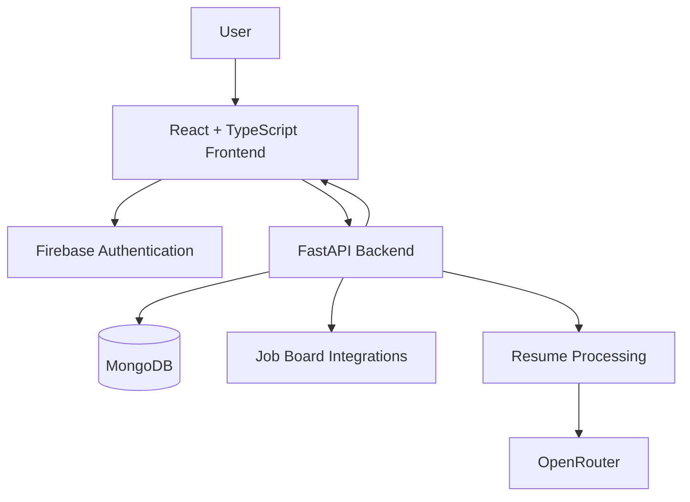

# ThoughtLabs CoPilot

AI-assisted job discovery, candidate management, resume analysis, application preparation, and application tracking — with human review kept in control.

> **Project status:** Active development. Features and setup may change as the project evolves.

## 1. What This Project Does

ThoughtLabs CoPilot is a web application with two main workspaces:

- **Job Seeker Workspace:** Discover jobs, save opportunities, compare job requirements with your profile, prepare application materials, and track application progress.
- **Recruiter Workspace:** Manage candidate profiles, upload and review resumes, inspect extracted candidate information, and track candidate-linked applications.

AI features use OpenRouter when configured. Resume extraction also has a local parser fallback.

**Important:** The application does not submit job applications automatically. Users review their materials and complete submissions on the employer's website.

## 2. Technology Stack

| Area | Technology |
|---|---|
| Frontend | React, TypeScript, Vite |
| UI Icons | Lucide React |
| Backend | Python, FastAPI, Uvicorn |
| Database | MongoDB, PyMongo |
| Authentication | Firebase Authentication |
| AI Integration | OpenRouter |
| Resume Reading | pypdf, DOCX extraction |
| PDF Generation | ReportLab |
| Job Discovery | JobSpy, Jobicy, Arbeitnow |
| Browser Support | Playwright, Google Chrome |
| Backend Testing | pytest |

## 3. Project Structure

```text
careerpilot-ai/
├── frontend/
│   ├── src/
│   │   ├── App.tsx
│   │   ├── ApplicationAssistant.tsx
│   │   ├── ApplyWorkflow.tsx
│   │   ├── AuthBoundary.tsx
│   │   ├── BenchCandidates.tsx
│   │   ├── RecruiterAdmin.tsx
│   │   ├── api.ts
│   │   ├── firebase.ts
│   │   ├── main.tsx
│   │   └── styles.css
│   ├── package.json
│   └── vite.config.ts
│
├── backend/
│   ├── app/
│   │   ├── main.py
│   │   ├── config.py
│   │   ├── database.py
│   │   ├── auth.py
│   │   ├── schemas.py
│   │   ├── workflow.py
│   │   ├── matching.py
│   │   ├── preferences.py
│   │   ├── resumes.py
│   │   ├── job_fetch.py
│   │   ├── job_import.py
│   │   ├── job_dedup.py
│   │   ├── jobspy_search.py
│   │   ├── europe_jobs.py
│   │   ├── jobicy.py
│   │   └── assistant_*.py
│   ├── tests/
│   ├── scripts/
│   ├── .env.example
│   ├── requirements.txt
│   └── requirements-local.txt
│
├── .gitignore
└── README.md
```

### Important Files Explained

| File | Responsibility |
|---|---|
| `frontend/src/App.tsx` | Main application UI, navigation, job cards and application board |
| `frontend/src/BenchCandidates.tsx` | Recruiter candidate management |
| `frontend/src/RecruiterAdmin.tsx` | Recruiter administration |
| `frontend/src/ApplyWorkflow.tsx` | Job application preparation workflow |
| `frontend/src/ApplicationAssistant.tsx` | Application Assistant interface |
| `frontend/src/api.ts` | Frontend API communication |
| `frontend/src/firebase.ts` | Firebase frontend configuration |
| `backend/app/main.py` | FastAPI routes and backend orchestration |
| `backend/app/database.py` | MongoDB connection and data access |
| `backend/app/auth.py` | Firebase authentication verification |
| `backend/app/workflow.py` | Application status workflow |
| `backend/app/matching.py` | Job matching logic |
| `backend/app/resumes.py` | Resume processing |
| `backend/app/config.py` | Backend environment configuration |
| `backend/tests/` | Automated backend tests |

## 4. Prerequisites

Install the following:

- Python 3.10 or newer
- Node.js and npm
- MongoDB local installation or MongoDB Atlas
- Firebase project
- OpenRouter API key (optional, for AI features)
- Google Chrome Stable (for local browser-assisted features)

## 5. Clone the Repository

```bash
git clone https://github.com/musahibpasha/careerpilot-ai.git
cd careerpilot-ai
```

If using a ZIP file, extract it and open the project folder in your code editor.

## 6. Backend Setup

### Step 1: Navigate to Backend

```bash
cd backend
```

### Step 2: Create Virtual Environment

**Windows PowerShell:**

```powershell
py -3 -m venv .venv
.\.venv\Scripts\Activate.ps1
```

**macOS/Linux:**

```bash
python3 -m venv .venv
source .venv/bin/activate
```

### Step 3: Install Dependencies

```bash
python -m pip install --upgrade pip
pip install -r requirements-local.txt
python -m playwright install chromium
```

### Step 4: Configure Environment Variables

Copy the example environment file.

**Windows:**

```powershell
Copy-Item .env.example .env
```

**macOS/Linux:**

```bash
cp .env.example .env
```

Edit `backend/.env`:

```env
APP_ENV=development

MONGODB_URL=mongodb://localhost:27017
MONGODB_DB=careerpilot

CORS_ORIGINS=http://localhost:5173

FIREBASE_PROJECT_ID=your-firebase-project-id
FIREBASE_SERVICE_ACCOUNT_JSON=

OPENROUTER_API_KEY=
OPENROUTER_MODEL=google/gemini-2.5-flash

OPENROUTER_FALLBACK_MODELS=
OPENROUTER_MAX_RETRIES=0

RESUME_PARSER_MODE=hybrid
RESUME_AI_TIMEOUT_SECONDS=30
```

**Configuration notes:**

- `MONGODB_URL`: Your MongoDB connection string.
- `MONGODB_DB`: Database name.
- `FIREBASE_PROJECT_ID`: Firebase project ID.
- `FIREBASE_SERVICE_ACCOUNT_JSON`: Backend Firebase Admin credentials, when using this configuration method.
- `OPENROUTER_API_KEY`: Your OpenRouter API key.
- `RESUME_PARSER_MODE`: Use `hybrid`, `ai`, or `local`.

Never commit `.env` files, credentials, or API keys.

### Step 5: Start Backend Server

```bash
python -m uvicorn app.main:app --reload
```

Backend:

```text
http://127.0.0.1:8000
```

API documentation:

```text
http://127.0.0.1:8000/docs
```

Keep this terminal running.

## 7. Frontend Setup

Open a second terminal from the project root.

### Step 1: Navigate to Frontend

```bash
cd frontend
```

### Step 2: Install Dependencies

```bash
npm install
```

### Step 3: Configure Firebase

Create `frontend/.env.local`:

```env
VITE_FIREBASE_API_KEY=your-firebase-web-api-key
VITE_FIREBASE_AUTH_DOMAIN=your-project.firebaseapp.com
VITE_FIREBASE_PROJECT_ID=your-firebase-project-id
VITE_FIREBASE_APP_ID=your-firebase-app-id
```

Get these values from:

Firebase Console → Project Settings → General → Your Apps → Web App.

Enable the required sign-in providers under Firebase Authentication.

Add `localhost` under Firebase Authentication → Settings → Authorized Domains.

### Step 4: Start Frontend

```bash
npm run dev
```

Open the URL displayed by Vite, normally:

```text
http://localhost:5173
```

## 8. Running the Complete Project

You need two terminals running simultaneously.

**Terminal 1 — Backend**

```bash
cd backend
.venv\Scripts\activate
python -m uvicorn app.main:app --reload
```

**Terminal 2 — Frontend**

```bash
cd frontend
npm run dev
```

Make sure MongoDB is running and Firebase is configured.

## 9. Testing

### Backend Tests

From the backend directory:

```bash
python -m pytest -q
```

### Frontend Build

From the frontend directory:

```bash
npm run build
```

### Frontend Preview

```bash
npm run preview
```

## 10. Application Architecture



### How It Works

1. The user interacts with the React frontend.
2. Firebase Authentication manages user identity.
3. The frontend sends authenticated API requests.
4. FastAPI validates requests and Firebase tokens.
5. MongoDB stores user profiles, jobs, applications, and recruiter records.
6. AI services assist with resume extraction and application-material drafts.
7. Results are returned to the frontend.

## 11. Main Features

### Job Seeker Workspace

- Job discovery from supported job boards.
- LinkedIn, Indeed and Glassdoor search.
- European job-feed aggregation.
- Job saving and duplicate detection.
- Explainable job matching.
- Resume analysis and extraction.
- Tailored resume and cover-letter drafts.
- Application tracking and status history.
- Application preparation workflow.
- Job preferences and filtering.

### Recruiter Workspace

- Candidate onboarding.
- Candidate profile management.
- Resume uploads and parsing.
- Candidate search and filtering.
- Skill matching.
- Candidate application tracking.
- Recruiter-managed notes.
- Recruiter administration.

### AI Capabilities

- Resume information extraction.
- Job/profile matching assistance.
- Cover-letter generation.
- Resume wording suggestions.
- Application answer drafts.

AI-generated content should always be reviewed before use.

## 12. Environment Variables Reference

| Variable | Description |
|---|---|
| `APP_ENV` | Backend environment |
| `MONGODB_URL` | MongoDB connection string |
| `MONGODB_DB` | Database name |
| `CORS_ORIGINS` | Allowed frontend origins |
| `FIREBASE_PROJECT_ID` | Firebase project |
| `FIREBASE_SERVICE_ACCOUNT_JSON` | Firebase Admin credentials |
| `SUPER_ADMIN_EMAILS` | Super-admin email allowlist |
| `OPENROUTER_API_KEY` | AI provider API key |
| `OPENROUTER_MODEL` | Primary AI model |
| `RESUME_PARSER_MODE` | Resume parsing mode |
| `VITE_FIREBASE_API_KEY` | Firebase frontend API key |
| `VITE_FIREBASE_AUTH_DOMAIN` | Firebase authentication domain |
| `VITE_FIREBASE_PROJECT_ID` | Firebase frontend project |
| `VITE_FIREBASE_APP_ID` | Firebase web application ID |
| `VITE_API_URL` | Optional deployed backend URL |

Additional settings are defined in `backend/app/config.py`.

## 13. Security and Privacy

- Never commit API keys or `.env` files.
- Keep Firebase service-account credentials on the backend.
- Do not expose MongoDB credentials in frontend code.
- Private workspace records must remain scoped to the authenticated Firebase UID.
- Review extracted resume information before saving.
- Review AI-generated content before using it.
- The application does not automatically submit applications.
- Do not bypass CAPTCHA, MFA, login restrictions, or website security controls.

## 14. Common Problems

| Problem | Possible Solution |
|---|---|
| MongoDB connection error | Check MongoDB service and connection URL. |
| Frontend API errors | Ensure backend is running and CORS is configured. |
| Firebase authentication error | Verify Firebase configuration and authorized domains. |
| OpenRouter error | Check API key, model availability and account credits. |
| Resume extraction failure | Try hybrid parsing or check the resume file. |
| Browser automation failure | Check Chrome installation and Playwright setup. |
| Frontend build failure | Run `npm install` and inspect TypeScript errors. |

## 15. Development Guidelines

Developers contributing to this project should:

1. Understand existing components and backend routes before modifying them.
2. Keep authentication and authorization checks on the backend.
3. Preserve Firebase UID-based data isolation.
4. Add tests for new backend functionality.
5. Run backend tests and frontend builds before submitting changes.
6. Never commit secrets or private user information.
7. Preserve human review and approval requirements.

## 16. Current Limitations

- Job-board availability depends on external services and their access restrictions.
- Scanned PDFs may require OCR support.
- AI-generated content can contain errors.
- Browser-assisted functionality depends on local browser configuration.
- The project is actively being developed, and features may change.

## License

No license has been selected yet. Until a license is added, do not assume the code is available for unrestricted reuse.

---

**Built to make job hunting more organized — with AI assistance and human control.** 🚀