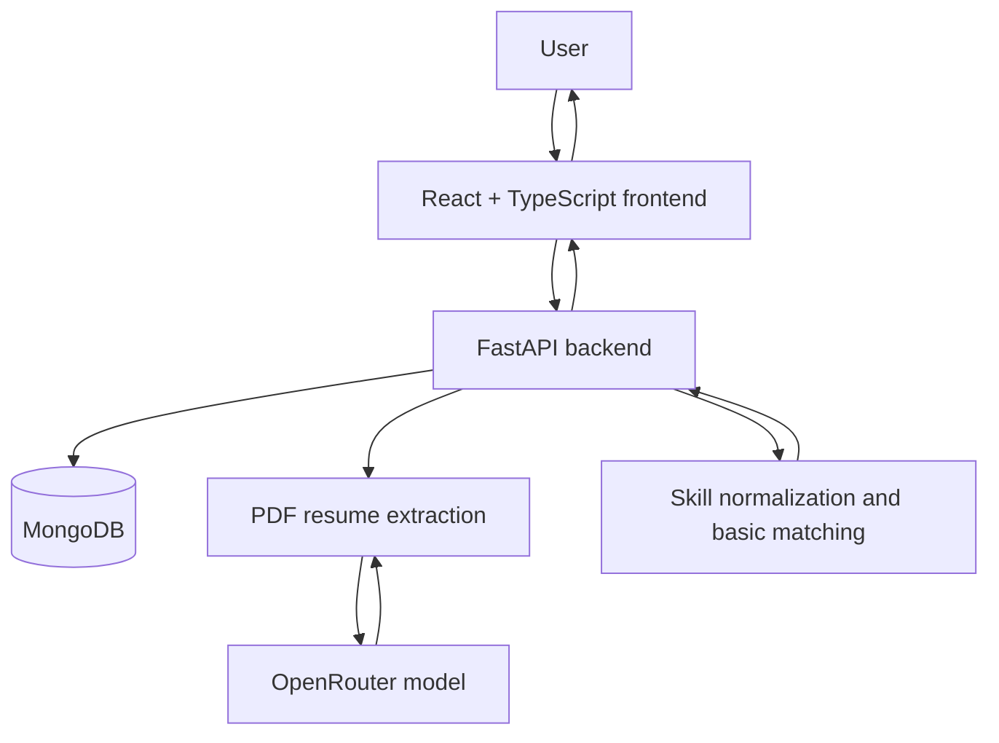

<div align="center">

# 🚀 CareerPilot AI

### 🤖 Your AI-Powered Job Hunt Copilot

[](https://git.io/typing-svg)

**Discover smarter. Match better. Apply with confidence.**

An AI-assisted job-search platform for organizing opportunities, understanding resume-to-job fit, preparing applications, and tracking the job hunt — while keeping important decisions under human control.


[Features](#-features) • [Architecture](#-architecture) • [Roadmap](#-development-roadmap) • [Setup](#-getting-started) • [Safety](#-safety-and-privacy)

</div>

---

## 📌 About the Project

CareerPilot AI is a personal job-hunt assistant designed to make job searching more organized and less repetitive. It brings a candidate profile, resume information, saved jobs, basic matching, and application-status tracking into one workspace.

The long-term goal is to support a human-approved workflow: find relevant opportunities, understand why a role may fit, prepare truthful application materials, and let the user review and approve any application before a submission action.

> **Guiding principle:** AI can assist with research and preparation, but the user stays in control of application decisions.

## ✨ Features

### ✅ Built

- **Candidate profile editor** — save contact details, professional summary, skills, work experience and internships, projects, education, certifications, and achievements.
- **PDF resume upload and parsing** — extract resume information with an AI-assisted parser using OpenRouter.
- **Review before saving** — inspect extracted resume fields and correct them before updating the profile.
- **Required-field validation** — frontend and backend checks for required profile fields.
- **Skill normalization** — treat common variations such as `React`, `React.js`, and `ReactJS` as the same skill for matching.
- **Manual job entry** — add a job with a title and company; a supplied link is validated.
- **Basic duplicate detection** — reject a job when its source ID or link already exists.
- **Basic skill-overlap match score** — calculate an initial score based on normalized skill overlap.
- **Job feed filtering and sorting** — filter by status, minimum match score, and source; sort by best match, newest, or company.
- **Application-status tracking** — track saved, drafting, needs review, interview, rejected, offer, and withdrawn statuses.
- **Safer loading behavior** — the job tracker can still load if the profile request fails.
- **Automated tests** — 30 tests currently cover areas including matching, normalization, duplicates, profile validation, resume parsing, and the application-approval block.

### 🚧 Planned

Features below are planned, not yet implemented unless explicitly listed in the Built section.

- Job-search preferences, including preferred roles, locations, work modes, and other filters.
- Resume version management.
- Detailed application status history, Kanban board, notes, and reminders.
- Paste-a-job import.
- Permitted job-source connectors, scheduled scans, and expired-listing checks.
- Explainable matching with weighted factors such as skills, experience, location, seniority, and salary.
- Separate must-have and nice-to-have requirements, missing-skill explanations, and match-confidence indicators.
- Relevant/not-relevant feedback to improve the usefulness of recommendations.
- Skill-gap reports.
- Tailored resume drafts, cover letters, application-answer drafts, document checklists, and ATS keyword checks.
- Playwright-assisted form prefill, with pauses for login, CAPTCHA, or uncertainty.
- A clear application review and approval screen backed by a server-side approval gate.
- Application activity logs and screenshots where appropriate.
- Dashboard analytics, alerts, and daily digests.
- Interview preparation tools.
- Login and private user data storage before wider online deployment.
- Further security, privacy, deployment, and reliability improvements.

## 🧭 Development Roadmap

Work is being delivered incrementally so each stage can be tested before moving on.

| Stage | Focus | Current state |
|---|---|---|
| 1 | Stabilize the existing app, database, tests, and basic approval block | ✅ Built |
| 2 | Profile and application tracking | 🟡 Basic version built; improvements remain |
| 3 | Smart, explainable job matching | 🔜 Planned |
| 4 | Job discovery, import, and permitted source connectors | 🔜 Planned |
| 5 | Application preparation and browser-assisted prefill | 🔜 Planned |
| 6 | Explicit approval workflow and server-side safeguards | 🔜 Planned |
| 7 | Analytics, alerts, interview preparation, authentication, security, and deployment | 🔜 Planned |

### Suggested implementation order

1. Finish Stage 2: job preferences, status history, Kanban, and resume versions.
2. Build Stage 3: explainable matching and skill-gap insights.
3. Build Stage 4: job import and permitted discovery sources.
4. Build Stage 5: application document preparation and safe form prefill.
5. Build Stage 6: a complete approval flow enforced by the backend.
6. Build Stage 7: analytics, notifications, authentication, and production hardening.

## 🏗️ Architecture



### Technology Stack

| Layer | Technology | Purpose |
|---|---|---|
| Frontend | React, TypeScript, Vite | User interface and job-tracking workspace |
| Backend | Python, FastAPI, Uvicorn | API, validation, and application logic |
| Database | MongoDB, PyMongo | Store profile and job-tracking data |
| Resume extraction | pypdf | Extract text from PDF resumes |
| AI extraction | OpenRouter | Assist with extracting structured profile fields |
| Testing | Python test suite | Validate key backend behaviors |

## 📂 Project Structure

```text
careerpilot-ai/
├── frontend/
│   └── src/
│       ├── App.tsx
│       └── styles.css
├── backend/
│   ├── app/
│   │   ├── main.py
│   │   ├── config.py
│   │   ├── database.py
│   │   ├── schemas.py
│   │   ├── matching.py
│   │   └── workflow.py
│   ├── .env                 # Local secrets; do not commit
│   └── .venv/               # Local virtual environment; do not commit
├── .github/
│   └── workflows/
│       └── snake.yml        # Optional contribution animation workflow
├── .gitignore
└── README.md
```

The exact structure may grow as new features are implemented.

## ⚙️ Getting Started

### Prerequisites

Install the following before running the project:

- Python 3.10 or a compatible newer version.
- Node.js and npm.
- A running MongoDB instance or MongoDB connection string.
- An OpenRouter API key if you want to use AI-assisted resume extraction.

### 1. Clone the Repository

Replace `musahibpasha` with your GitHub username.

```bash
git clone https://github.com/musahibpasha/careerpilot-ai.git
cd careerpilot-ai
```

### 2. Start the Backend

Open a terminal:

```bash
cd backend
python -m venv .venv
```

On Windows PowerShell, activate the environment:

```powershell
.\.venv\Scripts\Activate.ps1
```

Install dependencies:

```bash
pip install -r requirements.txt
```

Create `backend/.env` using the variable names expected by `backend/app/config.py`. Add your own MongoDB connection settings and OpenRouter API key locally.

**Never paste secrets into this README or commit your `.env` file.**

Start the API:

```bash
python -m uvicorn app.main:app --reload
```

If `requirements.txt` does not exist in your current repository yet, add a maintained dependency file based on the project's actual backend dependencies before relying on the install command above.

### 3. Start the Frontend

Open a second terminal:

```bash
cd frontend
npm install
npm run dev
```

Open the local URL printed by Vite in the terminal.

### 4. Run Tests

From the backend directory, activate the virtual environment and run the project's test command. For a standard pytest setup:

```bash
python -m pytest
```

Use the test command configured in the repository if it differs.

## 🔐 Safety and Privacy

CareerPilot AI is designed around human oversight.

- **No invented qualifications:** generated material should be based on the user's actual profile and resume.
- **Review before saving:** AI-extracted resume fields should be reviewed by the user before being saved.
- **No silent applications:** an application must not be submitted without explicit approval for that specific application.
- **Server-side enforcement matters:** a disabled frontend button alone is not a sufficient approval safeguard; the backend approval gate remains a planned improvement.
- **Respect website controls:** use permitted APIs, feeds, and automation methods. Do not bypass CAPTCHA, login requirements, or anti-bot protections.
- **Pause when uncertain:** automation should stop and ask the user when a page or form is unclear.
- **Protect secrets:** keep API keys, credentials, private resumes, and personal data out of source control and logs.
- **Secure before deployment:** authentication and private per-user storage are planned before broader online use.

The current match score is a basic skill-overlap indicator, not a guarantee of job suitability or hiring outcomes.

## 🧪 Testing

The current test suite contains 30 tests covering key areas such as:

- Skill normalization.
- Basic matching.
- Duplicate-job checks.
- Profile required-field validation.
- Resume parsing behavior.
- The current application-approval block.

As features are added, tests should be added for both successful and failure cases. The count may change as the project evolves.

## 🐍 Optional GitHub Contribution Snake

A contribution-snake animation is optional decoration and is separate from the application's functionality.

If the workflow at `.github/workflows/snake.yml` is configured and has successfully published the SVG to the `output` branch, you can display it here. Replace `musahibpasha` with your username:


If the image does not appear, check that the workflow ran successfully, that the `output` branch exists, and that the image path matches the generated filename. You can remove this section if you do not want the animation.

## 🛣️ Project Status

CareerPilot AI is an active work in progress. The profile editor, PDF resume parsing and review, skill normalization, manual job entry, basic matching, filters/sorting, and core status tracking are implemented. Advanced matching, job discovery integrations, document generation, browser-assisted workflows, the complete approval gate, analytics, authentication, and production deployment remain on the roadmap.

## 🤝 Contributing

This is currently a personal project. Suggestions, bug reports, and improvements are welcome as the project becomes more mature.

When contributing:

1. Keep changes focused on one feature at a time.
2. Add or update tests for changed behavior.
3. Never commit API keys, `.env` files, private resumes, or personal application data.
4. Preserve the human-approval requirement for any application submission workflow.

## 📄 License

No license has been selected yet. Until a license is added to this repository, do not assume that the code is available for unrestricted reuse.

---

<div align="center">

**Built to make job hunting more organized — with AI assistance and human control.** 🚀

</div>
