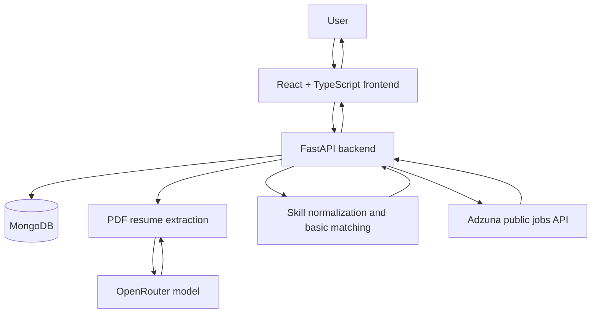

<div align="center">

# 🚀 CareerPilot AI

### 🤖 Your AI-Powered Job Hunt Copilot

[](https://git.io/typing-svg)

**Discover smarter. Match better. Apply with confidence.**

An AI-assisted job-search platform for organizing opportunities, understanding resume-to-job fit, preparing applications, and tracking the job hunt — while keeping important decisions under human control.


[Features](#-features) • [Architecture](#-architecture) • [Roadmap](#-development-roadmap) • [Setup](#-getting-started) • [Safety](#-safety-and-privacy)

</div>

---

## 📌 About the Project

CareerPilot AI is a personal job-hunt assistant designed to make job searching more organized and less repetitive. It brings a candidate profile, resume information, saved jobs, basic matching, and application-status tracking into one workspace.

The long-term goal is to support a human-approved workflow: find relevant opportunities, understand why a role may fit, prepare truthful application materials, and let the user review and approve any application before a submission action.

> **Guiding principle:** AI can assist with research and preparation, but the user stays in control of application decisions.

## ✨ Features

### ✅ Built

- **Candidate profile editor** — save contact details, professional summary, skills, work experience and internships, projects, education, certifications, and achievements.
- **PDF resume upload and parsing** — extract resume information with an AI-assisted parser using OpenRouter.
- **Review before saving** — inspect extracted resume fields and correct them before updating the profile.
- **Required-field validation** — frontend and backend checks for required profile fields.
- **Skill normalization** — treat common variations such as `React`, `React.js`, and `ReactJS` as the same skill for matching.
- **Manual job entry** — add a job with a title and company; a supplied link is validated.
- **Basic duplicate detection** — reject a job when its source ID or link already exists.
- **Basic skill-overlap match score** — calculate an initial score based on normalized skill overlap.
- **Job feed filtering and sorting** — filter by status, minimum match score, and source; sort by best match, newest, or company.
- **Application-status tracking with history** — statuses are Discovered, Saved, Under review, Ready for approval, Approved, Submitted, Interview, Offer, Rejected, and Withdrawn. Every change is recorded with a timestamp and shown in the tracker. Approved and Submitted are locked: the backend refuses them until the approval workflow is built. Applications saved under the older statuses are converted automatically on startup.
- **Job preferences** — save preferred locations, experience level, work arrangement (remote, hybrid, on-site), and salary expectation (minimum, maximum, currency, per year or month). Everything is optional, and target roles stay in the profile. Preferences feed the match score (see Explainable matching).
- **Multiple resumes with an active resume** — in your profile, keep up to 5 PDF resumes (5 MB each), view them, rename them, delete them, and choose one as the active resume (shown with an "Active" badge). A new application records the resume that was active when it was created and shows it in the tracker. Choosing a resume as active (or uploading your first one) reads it with the same AI parser as auto-fill and fills your profile form from it. The reading is kept with the resume, so switching back is instant, and "Re-read" reads it again. Nothing is saved to your profile until you review the form and click Save profile; closing the window without saving undoes it. The "Upload resume (PDF) and auto-fill" button at the top of the profile saves the file under My resumes and fills the form from it (when you already have 5 saved resumes it only fills the form and keeps nothing); "Add a resume" saves the file and fills the form only if it becomes your active resume. Uploading never changes your saved profile by itself. Resume files are stored in your local MongoDB, which is fine on your own machine, but login and protected storage are needed before the app is ever put online.
- **Explainable matching** — each job is scored 0-100 from weighted factors: skills (50, must-have vs nice-to-have), role fit against your target roles (15), location and work style (15), experience level (10) and salary (10). Every factor shows a plain-English reason, missing skills are listed, and a factor that cannot be judged (the job or your preferences do not say enough) is left out instead of counted as a miss. A low/medium/high confidence label shows how much of the picture was judged. Scores update when you save your profile or preferences, or call `POST /api/jobs/rescore`. Salary is only compared when both sides use the same currency. Each job card has a "Why this score?" panel with a bar per factor, the confidence label, missing skills, and the factors that were not counted; the add-job form has an optional "More details" section (nice-to-have skills, work style, level, salary).
- **Not interested, with a reason** — dismiss a job from its card and say why (role, skills, location, pay, level, company, other). Dismissed jobs move to a collapsible list with a Restore button, and after two dismissals for the same reason the app points you to the profile or preference setting that controls it. This is only recorded for now; it does not change scores.
- **Paste-a-job import** — in Add job, paste a whole posting and press Fill the form. Rules (not AI) read the title, company, location, work style, level, salary (LPA, lakh, $ ranges, monthly or yearly) and known skills, splitting must-have from nice-to-have. You review the filled form and save; nothing is saved automatically, and details it cannot find are listed so you can add them.
- **Job link import** — in Add job, leave the paste box empty, type a public job posting link in *Job posting URL* and press Fill the form. The backend (`app/job_fetch.py`) opens the page, pulls out the readable text (and the page's structured job data when it has some), then hands it to the same rule-based parser as pasted text, so you get the same kind of draft to review and edit before saving. If you paste text as well, the pasted text is used and the link is only kept as the posting URL. Safety rules: only `http`/`https` on ports 80/443; links to localhost, private, link-local, cloud-metadata and other internal addresses are refused (the name is looked up by the app, every answer is checked, and the connection goes to the checked address, so a name cannot be switched to an internal address afterwards); every redirect is re-checked, at most 5; 8-second total limit, 1 MB size limit, only HTML or plain-text pages; hidden page text and invisible characters are dropped, and text that looks like instructions to an AI is flagged and never followed. It does not log in, solve CAPTCHAs or get around blocking: if a site refuses, needs JavaScript or a login, the message tells you to paste the description instead. No new dependency was added.
- **Live public job discovery (Adzuna)** — the Find jobs screen can search live listings by keyword, optional location, Adzuna country code, and page. Results remain transient until you choose **Save job**; saved jobs use the existing `/api/jobs` endpoint, duplicate checks, and match scoring. Descriptions returned by Adzuna are snippets. Each result links to its Adzuna listing and displays the required Adzuna attribution. Add `ADZUNA_APP_ID` and `ADZUNA_APP_KEY` to `backend/.env`; never put these credentials in frontend code or source control. The provider documents the `gb` country example; India availability/country code is not yet verified. Automated tests use mocked responses; live data has not been verified because no API credentials are configured. Adzuna's free key is for evaluation, with account-specific limits; review the [API terms](https://developer.adzuna.com/docs/terms_of_service) before use, especially before public/commercial deployment.
- **Safer loading behavior** — the job tracker can still load if the profile request fails.
- **Automated tests** — cover areas including matching, normalization, duplicates, profile validation, resume parsing, status transitions, status history, the approval block, the status migration, job preferences, and resume files. Run `cd backend && python -m pytest -q`.

### 🚧 Planned

Features below are planned, not yet implemented unless explicitly listed in the Built section.

- Tailored resumes for each job, built only from your confirmed profile (planned for Stage 5), and using the active resume in job search and matching.
- Kanban board, notes, and reminders.
- Permitted job-source connectors, scheduled scans, and expired-listing checks.
- Relevant/not-relevant feedback to improve the usefulness of recommendations.
- Skill-gap reports.
- Tailored resume drafts, cover letters, application-answer drafts, document checklists, and ATS keyword checks.
- Playwright-assisted form prefill, with pauses for login, CAPTCHA, or uncertainty.
- A clear application review and approval screen backed by a server-side approval gate.
- Application activity logs and screenshots where appropriate.
- Dashboard analytics, alerts, and daily digests.
- Interview preparation tools.
- Login and private user data storage before wider online deployment.
- Further security, privacy, deployment, and reliability improvements.

## 🧭 Development Roadmap

Work is being delivered incrementally so each stage can be tested before moving on.

| Stage | Focus | Current state |
|---|---|---|
| 1 | Stabilize the existing app, database, tests, and basic approval block | ✅ Built |
| 2 | Profile and application tracking | 🟡 Status history, job preferences, and multiple resumes built; Kanban board remains |
| 3 | Smart, explainable job matching | ✅ Complete |
| 4 | Job discovery, import, and permitted source connectors | 🟡 Adzuna discovery implemented and mock-tested; live credentials and India country coverage remain unverified. Import is user-reported working. |
| 5 | Application preparation and browser-assisted prefill | 🔜 Planned |
| 6 | Explicit approval workflow and server-side safeguards | 🔜 Planned |
| 7 | Analytics, alerts, interview preparation, authentication, security, and deployment | 🔜 Planned |

### Suggested implementation order

1. ~~Stage 2: Kanban board, status history, job preferences, multiple resumes.~~ Done.
2. ~~Stage 3: explainable matching and skill-gap insights.~~ Done.
3. Finish Stage 4 verification: configure an Adzuna key, confirm the desired country code is supported, then manually test live results and saving.
4. Build Stage 5: application document preparation and safe form prefill.
5. Build Stage 6: a complete approval flow enforced by the backend.
6. Build Stage 7: analytics, notifications, authentication, and production hardening.

## 🏗️ Architecture



### Technology Stack

| Layer | Technology | Purpose |
|---|---|---|
| Frontend | React, TypeScript, Vite | User interface and job-tracking workspace |
| Backend | Python, FastAPI, Uvicorn | API, validation, and application logic |
| Database | MongoDB, PyMongo | Store profile and job-tracking data |
| Resume extraction | pypdf | Extract text from PDF resumes |
| AI extraction | OpenRouter | Assist with extracting structured profile fields |
| Testing | Python test suite | Validate key backend behaviors, including mocked Adzuna API responses |

## 📂 Project Structure

```text
careerpilot-ai/
├── frontend/
│   └── src/
│       ├── App.tsx
│       └── styles.css
├── backend/
│   ├── app/
│   │   ├── main.py
│   │   ├── adzuna.py
│   │   ├── config.py
│   │   ├── database.py
│   │   ├── schemas.py
│   │   ├── preferences.py
│   │   ├── resumes.py
│   │   ├── matching.py
│   │   └── workflow.py
│   ├── .env                 # Local secrets; do not commit
│   └── .venv/               # Local virtual environment; do not commit
├── .github/
│   └── workflows/
│       └── snake.yml        # Optional contribution animation workflow
├── .gitignore
└── README.md
```

The exact structure may grow as new features are implemented.

## ⚙️ Getting Started

### Prerequisites

Install the following before running the project:

- Python 3.10 or a compatible newer version.
- Node.js and npm.
- A running MongoDB instance or MongoDB connection string.
- An OpenRouter API key if you want to use AI-assisted resume extraction.

### 1. Clone the Repository

Replace `musahibpasha` with your GitHub username.

```bash
git clone https://github.com/musahibpasha/careerpilot-ai.git
cd careerpilot-ai
```

### 2. Start the Backend

Open a terminal:

```bash
cd backend
python -m venv .venv
```

On Windows PowerShell, activate the environment:

```powershell
.\.venv\Scripts\Activate.ps1
```

Install dependencies:

```bash
pip install -r requirements.txt
```

Create `backend/.env` using the variable names expected by `backend/app/config.py`. Add your own MongoDB connection settings and OpenRouter API key locally.

**Never paste secrets into this README or commit your `.env` file.**

To try live job discovery, register through [Adzuna's developer portal](https://developer.adzuna.com/signup), review its [API terms](https://developer.adzuna.com/docs/terms_of_service), then add your credentials to `backend/.env`:

```dotenv
ADZUNA_APP_ID=your_app_id
ADZUNA_APP_KEY=your_app_key
```

Restart FastAPI after changing `.env`. The API docs show `gb` as an example country code; India coverage and its country code have not yet been confirmed. Adzuna's free key is intended for evaluation, and current limits are shown in the account. Its terms require removal of Adzuna data from displayed pages if access is terminated; this app currently has no provider-specific deletion UI, so do not terminate API access until saved Adzuna entries can be removed from MongoDB. Live API behavior remains unverified until you configure credentials.

Start the API:

```bash
python -m uvicorn app.main:app --reload
```

If `requirements.txt` does not exist in your current repository yet, add a maintained dependency file based on the project's actual backend dependencies before relying on the install command above.

### 3. Start the Frontend

Open a second terminal:

```bash
cd frontend
npm install
npm run dev
```

Open the local URL printed by Vite in the terminal.

### 4. Run Tests

From the backend directory, activate the virtual environment and run the project's test command. For a standard pytest setup:

```bash
python -m pytest
```

Use the test command configured in the repository if it differs.

## 🔐 Safety and Privacy

CareerPilot AI is designed around human oversight.

- **No invented qualifications:** generated material should be based on the user's actual profile and resume.
- **Review before saving:** AI-extracted resume fields should be reviewed by the user before being saved.
- **No silent applications:** an application must not be submitted without explicit approval for that specific application.
- **Server-side enforcement matters:** a disabled frontend button alone is not a sufficient approval safeguard; the backend approval gate remains a planned improvement.
- **Respect website controls:** use permitted APIs, feeds, and automation methods. Do not bypass CAPTCHA, login requirements, or anti-bot protections.
- **Pause when uncertain:** automation should stop and ask the user when a page or form is unclear.
- **Protect secrets:** keep API keys, credentials, private resumes, and personal data out of source control and logs.
- **Secure before deployment:** authentication and private per-user storage are planned before broader online use.

The current match score is a basic skill-overlap indicator, not a guarantee of job suitability or hiring outcomes.

## 🧪 Testing

The test suite (run with `cd backend && python -m pytest -q`) covers key areas such as:

- Skill normalization.
- Basic matching.
- Duplicate-job checks.
- Profile required-field validation.
- Resume parsing behavior.
- Application status transitions, timestamped status history, and the migration from the old statuses.
- The application-approval block: `approved` and `submitted` are refused by the backend.
- Job link import (`tests/test_job_fetch.py`, `tests/test_job_import_url.py`): valid public HTML, structured job data, malformed/empty pages, login and CAPTCHA pages, unsupported content types, timeouts, oversized responses, redirect limit, localhost/private/metadata/IPv6 targets, redirects to private addresses, names that resolve to internal addresses, and the pasted-text regression. No test opens a real website.

As features are added, tests should be added for both successful and failure cases. The count may change as the project evolves.

## 🐍 Optional GitHub Contribution Snake

A contribution-snake animation is optional decoration and is separate from the application's functionality.

If the workflow at `.github/workflows/snake.yml` is configured and has successfully published the SVG to the `output` branch, you can display it here. Replace `musahibpasha` with your username:


If the image does not appear, check that the workflow ran successfully, that the `output` branch exists, and that the image path matches the generated filename. You can remove this section if you do not want the animation.

## 🛣️ Project Status

CareerPilot AI is an active work in progress. The profile editor, PDF resume parsing and review, skill normalization, manual job entry, basic matching, filters/sorting, and application status tracking with history, job preferences, and multiple resumes are implemented. Advanced matching, job discovery integrations, document generation, browser-assisted workflows, the complete approval gate, analytics, authentication, and production deployment remain on the roadmap.

## 🤝 Contributing

This is currently a personal project. Suggestions, bug reports, and improvements are welcome as the project becomes more mature.

When contributing:

1. Keep changes focused on one feature at a time.
2. Add or update tests for changed behavior.
3. Never commit API keys, `.env` files, private resumes, or personal application data.
4. Preserve the human-approval requirement for any application submission workflow.

## 📄 License

No license has been selected yet. Until a license is added to this repository, do not assume that the code is available for unrestricted reuse.

---

<div align="center">

**Built to make job hunting more organized — with AI assistance and human control.** 🚀

</div>