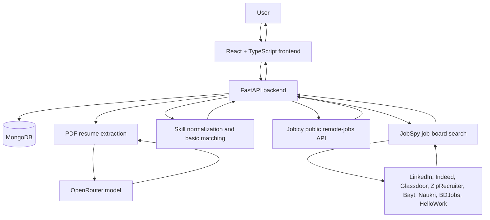

<div align="center">

# 🚀 CareerPilot AI

### 🤖 Your AI-Powered Job Hunt Copilot

[](https://git.io/typing-svg)

**Discover smarter. Match better. Apply with confidence.**

An AI-assisted job-search platform for organizing opportunities, understanding resume-to-job fit, preparing applications, and tracking the job hunt — while keeping important decisions under human control.


[Features](#-features) • [Architecture](#-architecture) • [Roadmap](#-development-roadmap) • [Setup](#-getting-started) • [Safety](#-safety-and-privacy)

</div>

---

## 📌 About the Project

CareerPilot AI is a personal job-hunt assistant designed to make job searching more organized and less repetitive. It brings a candidate profile, resume information, saved jobs, basic matching, and application-status tracking into one workspace.

The long-term goal is to support a human-approved workflow: find relevant opportunities, understand why a role may fit, prepare truthful application materials, and let the user review and approve any application before a submission action.

> **Guiding principle:** AI can assist with research and preparation, but the user stays in control of application decisions.

## ✨ Features

### ✅ Built

- **Candidate profile editor** — save contact details, professional summary, skills, work experience and internships, projects, education, certifications, and achievements.
- **PDF resume upload and parsing** — extract resume information with an AI-assisted parser using OpenRouter.
- **Review before saving** — inspect extracted resume fields and correct them before updating the profile.
- **Required-field validation** — frontend and backend checks for required profile fields.
- **Skill normalization** — treat common variations such as `React`, `React.js`, and `ReactJS` as the same skill for matching.
- **Manual job entry** — add a job with a title and company; a supplied link is validated.
- **Basic duplicate detection** — reject a job when its source ID or link already exists.
- **Basic skill-overlap match score** — calculate an initial score based on normalized skill overlap.
- **Job feed filtering and sorting** — filter by status, minimum match score, and source; sort by best match, newest, or company.
- **Application-status tracking with history** — statuses are Discovered, Saved, Under review, Ready for approval, Approved, Submitted, Interview, Offer, Rejected, and Withdrawn. Every change is recorded with a timestamp and shown in the tracker. The generic status endpoints still refuse direct Approved/Submitted changes; the Application Assistant has the dedicated review and manual-submission-confirmation flow.
- **Job preferences** — save preferred locations, experience level, work arrangement (remote, hybrid, on-site), and salary expectation (minimum, maximum, currency, per year or month). Everything is optional, and target roles stay in the profile. Preferences feed the match score (see Explainable matching).
- **Multiple resumes with an active resume** — in your profile, keep up to 5 PDF resumes (5 MB each), view them, rename them, delete them, and choose one as the active resume (shown with an "Active" badge). A new application records the resume that was active when it was created and shows it in the tracker. Choosing a resume as active (or uploading your first one) reads it with the same AI parser as auto-fill and fills your profile form from it. The reading is kept with the resume, so switching back is instant, and "Re-read" reads it again. Nothing is saved to your profile until you review the form and click Save profile; closing the window without saving undoes it. The "Upload resume (PDF) and auto-fill" button at the top of the profile saves the file under My resumes and fills the form from it (when you already have 5 saved resumes it only fills the form and keeps nothing); "Add a resume" saves the file and fills the form only if it becomes your active resume. Uploading never changes your saved profile by itself. Resume records are scoped to the signed-in Firebase UID.
- **Explainable matching** — each job is scored 0-100 from weighted factors: skills (50, must-have vs nice-to-have), role fit against your target roles (15), location and work style (15), experience level (10) and salary (10). Every factor shows a plain-English reason, missing skills are listed, and a factor that cannot be judged (the job or your preferences do not say enough) is left out instead of counted as a miss. A low/medium/high confidence label shows how much of the picture was judged. Scores update when you save your profile or preferences, or call `POST /api/jobs/rescore`. Salary is only compared when both sides use the same currency. Each job card has a "Why this score?" panel with a bar per factor, the confidence label, missing skills, and the factors that were not counted; the add-job form has an optional "More details" section (nice-to-have skills, work style, level, salary).
- **Application preparation plan** — Match analysis shows a deterministic fit summary, strengths, gaps, resume focus, positioning guidance, and interview prompts based on the saved job and profile. It is guidance, not AI-generated document text.
- **AI cover-letter and resume wording drafts** — from a job's Match analysis, choose **Generate cover letter and resume drafts** to request a tailored cover letter, professional-summary rewrite, relevant saved skills to emphasize, and suggestions for rewriting existing experience/project bullets. Drafts use the saved profile and job posting, are editable in the panel, and are not submitted or saved automatically. Contact details are excluded from the AI request. Review all text for accuracy. The reviewed cover letter can be downloaded as a real PDF containing the candidate's saved contact details and the selected job context.
- **Tailored resume export** — download a printable HTML resume built from your saved profile and the edited AI summary/bullet suggestions. Open the file in a browser and choose Print / Save as PDF. Existing education, work history, projects, and skills are preserved; generated wording is only used where its source still matches the saved profile. The original uploaded PDF and saved profile are not changed.
- **Application Assistant / Automate** — open from a job card or tracker entry for a persistent, job-specific workflow. It combines grounded answer drafts, AI-tailored cover-letter/resume wording, the active saved PDF resume, and browser-assisted form fill on Greenhouse and Lever forms and Glassdoor job listings. Opening **Automate** on a saved Glassdoor listing opens installed Google Chrome with a dedicated local profile; sign in yourself and open the application form, then CareerPilot fills matching confirmed kit fields. The OpenRouter key is used by the backend to draft answers from the saved profile and job posting; it is never sent to Glassdoor. Glassdoor session cookies stay in the separate profile outside the repository. CareerPilot never enters or stores credentials, clicks Submit, or solves CAPTCHAs. If Glassdoor's security page blocks Chrome, CareerPilot reports the block and does not attempt to bypass it; open Glassdoor in your regular browser and use the Application Kit. Glassdoor sign-in requests are allowed only while a Glassdoor sign-in form is detected; application form requests remain blocked until you review and explicitly authorize them. Resume upload requires explicit consent. You click the employer's Submit control yourself and separately record that action in CareerPilot. Redirects outside the supported employer site are blocked.
- **Not interested, with a reason** — dismiss a job from its card and say why (role, skills, location, pay, level, company, other). Dismissed jobs move to a collapsible list with a Restore button, and after two dismissals for the same reason the app points you to the profile or preference setting that controls it. This is only recorded for now; it does not change scores.
- **Paste-a-job import** — in Add job, paste a whole posting and press Fill the form. Rules (not AI) read the title, company, location, work style, level, salary (LPA, lakh, $ ranges, monthly or yearly) and known skills, splitting must-have from nice-to-have. You review the filled form and save; nothing is saved automatically, and details it cannot find are listed so you can add them.
- **Job link import** — in Add job, leave the paste box empty, type a public job posting link in *Job posting URL* and press Fill the form. The backend (`app/job_fetch.py`) opens the page, pulls out the readable text (and the page's structured job data when it has some), then hands it to the same rule-based parser as pasted text, so you get the same kind of draft to review and edit before saving. If you paste text as well, the pasted text is used and the link is only kept as the posting URL. Safety rules: only `http`/`https` on ports 80/443; links to localhost, private, link-local, cloud-metadata and other internal addresses are refused (the name is looked up by the app, every answer is checked, and the connection goes to the checked address, so a name cannot be switched to an internal address afterwards); every redirect is re-checked, at most 5; 8-second total limit, 1 MB size limit, only HTML or plain-text pages; hidden page text and invisible characters are dropped, and text that looks like instructions to an AI is flagged and never followed. It does not log in, solve CAPTCHAs or get around blocking: if a site refuses, needs JavaScript or a login, the message tells you to paste the description instead. The JobSpy dependency is used for board discovery, not posting-link import.
- **Job-board source cards and search (JobSpy)** — Find Jobs provides separate source cards for LinkedIn, Indeed, Glassdoor, ZipRecruiter, Bayt, Naukri, BDJobs, and HelloWork. Selecting a board and searching calls [JobSpy](https://github.com/speedyapply/JobSpy) for up to 20 results using the entered keywords and location, plus supported work-type, remote, and recency filters. Results are transient until saved, then use the existing duplicate checks and match scoring. A saved Glassdoor listing opens the local sign-in-and-fill workflow; direct Greenhouse or Lever application URLs are also retained and supported. Other direct destinations are not used for autofill. Descriptions and other fields depend on what each board returns; some boards can block or rate-limit requests. No credentials or proxies are configured, and the resume is not sent to boards.
- **Live remote-job discovery (Jobicy)** — Find Jobs retains Jobicy's public, no-key [Jobs API](https://jobicy.com/jobs-rss-feed), which documents use for discovery products and prototypes. Results are transient until saved, then use the existing duplicate checks and match scoring. The API provides remote roles published in the past seven days, keyword search, broad region filters (including APAC and Europe), and cursor pagination. It does not provide India- or city-specific filters; the optional location text is checked locally against each listing's stated eligibility, which may be broad or unavailable. Listings link to Jobicy and display Jobicy attribution as required. Public results link to the Jobicy listing, not a direct employer application URL. No credentials or paid API are used.
- **Safer loading behavior** — the job tracker can still load if the profile request fails.
- **Automated tests** — cover areas including matching, normalization, duplicates, profile validation, resume parsing, status transitions, status history, the approval block, the status migration, job preferences, and resume files. Run `cd backend && python -m pytest -q`.

### 🚧 Planned

Features below are planned, not yet implemented unless explicitly listed in the Built section.

- Using the active uploaded resume directly in job matching and importing the exported resume back into the stored resume library.
- Document checklists and ATS keyword checks.
- Permitted job-source connectors, scheduled scans, and expired-listing checks.
- Application activity logs and screenshots where appropriate.
- Advanced interview preparation tools beyond the basic prompts in the application plan.
- Dashboard analytics, alerts, and daily digests.
- Login and private user data storage before wider online deployment.
- Further security, privacy, deployment, and reliability improvements.

## 🧭 Development Roadmap

Work is being delivered incrementally so each stage can be tested before moving on.

| Stage | Focus | Current state |
|---|---|---|
| 1 | Stabilize the existing app, database, tests, and basic approval block | ✅ Built |
| 2 | Profile and application tracking | ✅ Profile, preferences, multiple resumes, status history, and Kanban board built |
| 3 | Smart, explainable job matching | ✅ Complete |
| 4 | Job discovery, import, and permitted source connectors | ✅ Manual entry, posting import, Jobicy remote listings, and JobSpy-powered job-board searches are available. |
| 5 | Application preparation and browser-assisted prefill | ✅ Application kits, editable grounded answer drafts, permitted browser-assisted fill, and LinkedIn manual workflow are built alongside existing document prep. |
| 6 | Explicit approval workflow and server-side safeguards | ✅ Review hashes, guarded approval transitions, and user-confirmed manual submission are enforced by the backend. |
| 7 | Analytics, alerts, interview preparation, authentication, security, and deployment | 🔄 Firebase auth and per-user isolation implemented; Firebase setup and approved data migration pending |

### Current implementation checkpoint

- **Current feature:** Job-board source cards and transient JobSpy search results, alongside the persistent Application Assistant workflow for saved jobs and tracker entries.
- **Status:** Application-kit edits and generated answers persist on the existing application record. AI answer generation uses the existing OpenRouter integration with fact-grounded template fallback. Review approval is tied to a hash of the job and exact answers; Submitted is recorded only after the user confirms they submitted externally. No external application is submitted by CareerPilot.
- **Job-board searches:** Find Jobs can retrieve transient listings from the selected JobSpy-supported board. Results are saved only after the user chooses **Save job**; the original posting remains the source link.
- **Profile handling:** Suggested keywords come only from saved target roles (or saved skills if no roles exist); location and optional preferences can be seeded from saved profile/preferences. The user can edit every criterion before searching.
- **LinkedIn access:** The official Job Posting API is partner-restricted and is for posting jobs, not searching listings. JobSpy provides public-board search without using a LinkedIn account or session; availability is subject to board blocking and rate limits. Application automation remains disabled for LinkedIn.
- **Preserved integration:** The current workspace has a Jobicy connector, not a Jobify connector. Jobicy remains intact; the existing public job URL importer is unchanged.
- **Automated checks:** Run the backend suite and frontend build after implementation; browser integration tests require Playwright Chromium.
- **Search verification:** Backend tests cover source validation, filter forwarding, URL safety, and result normalization. Live board searches were not run as part of the automated tests; each source may have its own access limits.
- **Manual confirmation:** Not yet confirmed by the user.
- **Next after user verification:** Manually test the Application Assistant flow below before starting another feature.

### Suggested implementation order

1. ~~Stage 2: Kanban board, status history, job preferences, multiple resumes.~~ Done.
2. ~~Stage 3: explainable matching and skill-gap insights.~~ Done.
3. Complete search filters and result normalization, including the limits of each source's available data.
4. Verify Stage 5 and Stage 6 in the Application Assistant, then continue with active-resume-aware matching.
5. Continue Stage 7: analytics, notifications, and production hardening.

## 🏗️ Architecture



### Technology Stack

| Layer | Technology | Purpose |
|---|---|---|
| Frontend | React, TypeScript, Vite | User interface and job-tracking workspace |
| Backend | Python, FastAPI, Uvicorn | API, validation, and application logic |
| Database | MongoDB, PyMongo | Store profile and job-tracking data |
| Resume extraction | pypdf | Extract text from PDF resumes |
| PDF generation | ReportLab | Render reviewed cover letters as downloadable PDFs |
| AI extraction | OpenRouter | Assist with extracting structured profile fields |
| Testing | Python test suite | Validate backend behaviors across profiles, jobs, matching, imports, and application tracking |

## 📂 Project Structure

```text
careerpilot-ai/
├── frontend/
│   └── src/
│       ├── App.tsx
│       └── styles.css
├── backend/
│   ├── app/
│   │   ├── main.py
│   │   ├── jobicy.py
│   │   ├── config.py
│   │   ├── database.py
│   │   ├── schemas.py
│   │   ├── preferences.py
│   │   ├── resumes.py
│   │   ├── matching.py
│   │   └── workflow.py
│   ├── tests/
│   │   └── test_jobicy.py
│   ├── .env                 # Local secrets; do not commit
│   └── .venv/               # Local virtual environment; do not commit
├── .github/
│   └── workflows/
│       └── snake.yml        # Optional contribution animation workflow
├── .gitignore
└── README.md
```

The exact structure may grow as new features are implemented.

## ⚙️ Getting Started

### Deploying on Vercel

The frontend and API are deployed as separate Vercel projects from this
repository. Create the frontend project with `frontend` as its root directory
and the backend project with `backend` as its root directory. The backend's
`api/[...path].py` exports the FastAPI application for Vercel's Python runtime;
the existing `backend/requirements.txt` is used for its dependencies.

Set these backend environment variables in the Vercel project:

- `MONGODB_URL` — MongoDB Atlas connection string.
- `MONGODB_DB` — database name, for example `careerpilot`.
- `CORS_ORIGINS` — exact deployed frontend origin, such as `https://your-site.vercel.app`.
- `APP_ENV=production`.
- `OPENROUTER_API_KEY` — optional; required for AI-generated drafts.
- `FIREBASE_PROJECT_ID` — Firebase project ID used by the Admin SDK.
- `FIREBASE_SERVICE_ACCOUNT_JSON` — private service-account JSON, stored as a backend-only secret.

Set `VITE_API_URL` in the frontend project to the backend's deployed origin
(for example `https://your-api.vercel.app`) and redeploy the frontend. Never
put database credentials or the OpenRouter key in a `VITE_` variable. The
frontend falls back to localhost only in development; a production build with
no API URL uses same-origin `/api` requests.

Set these frontend values in `frontend/.env.local` for local development and
in the frontend Vercel project for production:

- `VITE_FIREBASE_API_KEY`
- `VITE_FIREBASE_AUTH_DOMAIN`
- `VITE_FIREBASE_PROJECT_ID`
- `VITE_FIREBASE_APP_ID`

These are Firebase Web App configuration values, not server credentials.
Enable Email/Password and Google under **Firebase Console → Authentication →
Sign-in method**, and add `localhost` and the deployed frontend host under
**Authentication → Settings → Authorized domains**. The app requires verified
email addresses before accessing workspace APIs.

The backend verifies Firebase ID tokens with the Firebase Admin SDK. It does
not trust an email, UID, or owner field from request data. Each request is
scoped to the UID from its verified token; profile, preferences, jobs,
applications, resumes, and assistant operations all use that scope. Public
health, transient job-board search, and non-persisting job-import preview
remain unauthenticated.

#### Existing workspace data reconciliation

Legacy records remain hidden from the authenticated API until their ownership
is reconciled. The earlier ownership-only utility is not the import tool for
reconciling local backups with Atlas. Use the separate
`scripts/reconcile_legacy_workspace.py` tool only after preparing all five
Extended JSON collection exports (`jobs.json`, `applications.json`,
`profiles.json`, `preferences.json`, and `resumes.json`).

The script defaults to read-only dry-run mode. It requires the explicit
`CAREERPILOT_MIGRATION_ATLAS_URL` variable and `--atlas-db careerpilot`; it
never falls back to the backend's `MONGODB_URL`. It also prompts for a current
Firebase ID token with hidden input, verifies the token through Firebase
Admin, and derives the UID from verified claims. Do not pass an email or UID
as identity proof. Example:

```powershell
cd backend
$env:CAREERPILOT_MIGRATION_ATLAS_URL = "<Atlas URI supplied through your secret manager>"
python scripts/reconcile_legacy_workspace.py --dry-run --backup-dir ".\migration-backups" --atlas-db careerpilot --expected-email "your-verified-account@example.com"
```

The tool does not overwrite existing documents or alter indexes. It plans
ownership-only updates for matching records, preserves Atlas-only records,
and handles profile conflicts and UID-tagged local-only records separately.
An apply run is additionally gated by a reviewed manifest hash, exact target
confirmation, independently verified backups of both databases, successful
isolated restore and staging reconciliation attestations, and a final typed
target confirmation. The readiness file must identify hashed local and Atlas
database backup archives, the hash of the five JSON source exports, and who
verified successful restore and staging checks. JSON parse counts alone are
not evidence that a database backup can be restored. Do not use the older
`assign_legacy_workspace.py` utility for this reconciliation. Never put the
service-account JSON in the frontend, README, or Git.

Vercel serverless functions cannot keep an interactive browser open. The
browser-assisted **Fill** endpoint returns `503` on Vercel; use the Application
Kit to review and copy answers. Firebase authentication does not make an
interactive browser available inside Vercel.
Resume uploads may also exceed serverless request-size limits; if that occurs,
use direct object-storage uploads rather than raising the function limit.

### Prerequisites

Install the following before running the project:

- Python 3.10 or a compatible newer version.
- Node.js and npm.
- A running MongoDB instance or MongoDB connection string.
- An OpenRouter API key if you want to use AI-assisted resume extraction and application-draft generation.

### 1. Clone the Repository

Replace `musahibpasha` with your GitHub username.

```bash
git clone https://github.com/musahibpasha/careerpilot-ai.git
cd careerpilot-ai
```

### 2. Start the Backend

Open a terminal:

```bash
cd backend
python -m venv .venv
```

On Windows PowerShell, activate the environment:

```powershell
.\.venv\Scripts\Activate.ps1
```

Install dependencies:

```bash
pip install -r requirements.txt
python -m playwright install chromium
```

Create `backend/.env` using the variable names expected by `backend/app/config.py`. Add your own MongoDB connection settings and OpenRouter API key locally.

**Never paste secrets into this README or commit your `.env` file.**

The local fake application form is disabled by default. To enable it for local testing only, set `ASSISTANT_ALLOW_LOCAL_TEST_FORM=true` and keep `APP_ENV=development` (or `test`) in `backend/.env`.

Start the API:

```bash
python -m uvicorn app.main:app --reload
```

If `requirements.txt` does not exist in your current repository yet, add a maintained dependency file based on the project's actual backend dependencies before relying on the install command above.

### 3. Start the Frontend

Open a second terminal:

```bash
cd frontend
npm install
npm run dev
```

Open the local URL printed by Vite in the terminal.

### 4. Run Tests

From the backend directory, activate the virtual environment and run the project's test command. For a standard pytest setup:

```bash
python -m pytest
```

Use the test command configured in the repository if it differs.

## 🔐 Safety and Privacy

CareerPilot AI is designed around human oversight.

- **No invented qualifications:** generated material should be based on the user's actual profile and resume.
- **Review before saving:** AI-extracted resume fields should be reviewed by the user before being saved.
- **No automatic applications:** CareerPilot never clicks Submit. The visible browser blocks form writes until the user confirms the reviewed application and explicitly enables manual form requests; the user must then click the employer's Submit control. Enabling requests may allow the site to react, so only do this after checking the form.
- **Server-side approval:** `approved` requires confirmation of the exact reviewed job and answers. `submitted` can only be recorded after the user explicitly confirms manual submission. Generic status endpoints continue to reject both statuses.
- **Respect website controls:** use permitted APIs, feeds, and automation methods. Do not bypass CAPTCHA, login requirements, or anti-bot protections.
- **Pause when uncertain:** automation should stop and ask the user when a page or form is unclear.
- **Protect secrets:** keep API keys, credentials, private resumes, and personal data out of source control and logs.
- **Secure deployment:** workspace data APIs require a verified Firebase account and enforce per-user ownership.

The current match score is a basic skill-overlap indicator, not a guarantee of job suitability or hiring outcomes.

## 🧪 Testing

The test suite (run with `cd backend && python -m pytest -q`) covers key areas such as:

- Skill normalization.
- Basic matching.
- Duplicate-job checks.
- Profile required-field validation.
- Resume parsing behavior.
- Application status transitions, timestamped status history, and the migration from the old statuses.
- The application-approval block: `approved` and `submitted` are refused by the backend.
- Application Assistant (`tests/test_assistant.py`): fact and draft persistence, tailored-material persistence and review hashing, saved-resume selection and consented upload, grounded AI/template answers, Greenhouse/Lever/Glassdoor URL policy, source-listing versus application-URL separation, LinkedIn/private-host restrictions, safe same-platform navigation and redirect checks, Glassdoor login-write scoping and application-form detection, sensitive-field handling, browser write blocking and post-review manual authorization, isolated browser-form tests, explicit manual-submission recording, and regressions for the generic status gates. Browser-driven tests require Playwright Chromium.
- Authentication and data scoping (`tests/test_auth.py`): bearer-token rejection, verified-email enforcement, owner assignment on inserts, cross-user ID read/update/delete isolation, and protection against attempts to spoof an owner UID.
- Cover-letter PDF export: checks the PDF response and verifies the reviewed letter and selected job/profile context in extracted PDF text.
- Job link import (`tests/test_job_fetch.py`, `tests/test_job_import_url.py`): valid public HTML, structured job data, malformed/empty pages, login and CAPTCHA pages, unsupported content types, timeouts, oversized responses, redirect limit, localhost/private/metadata/IPv6 targets, redirects to private addresses, names that resolve to internal addresses, and the pasted-text regression. No test opens a real website.

As features are added, tests should be added for both successful and failure cases. The count may change as the project evolves.

### Manually test the Application Assistant

1. Start MongoDB, the backend, and the frontend. Add a profile with contact details, skills, experience, and projects, then save a job.
2. Click **Automate** on a job card (or open the assistant from Applications). Confirm that the assistant reuses that job's application record.
3. In **Job**, choose the saved resume for this application. In **Kit**, check profile facts and source labels; generate and edit answer drafts and tailored materials; save changes and reopen the assistant to confirm persistence.
4. Open **Fill**. A saved Greenhouse or Lever page can be autofilled directly. For a saved Glassdoor job, **Automate** opens installed Google Chrome with a dedicated local profile; sign in yourself and open the listing's application form in that window. CareerPilot waits for a supported Glassdoor form, fills matching confirmed details, and stops before submission. The profile stores Glassdoor session cookies on this machine, outside the repository; do not share that profile folder. If Glassdoor displays a “Humans only” security block, CareerPilot reports it instead of trying to get around the block; use your regular browser and copy reviewed answers from the Application Kit. You can also paste a Glassdoor job-listing URL into **Employer application URL**. Other unsupported destinations use the Application Kit manually. To attach your active PDF resume, check the upload-consent box first. LinkedIn remains manual.
5. Review the open employer form and field results in CareerPilot. Fields CareerPilot cannot confidently match remain for you to answer. In **Review**, confirm the exact answers and tailored materials.
6. In **Done**, explicitly enable form requests only if you intend to use the open browser, then click the employer's Submit control yourself. CareerPilot never clicks it. If not using that browser, submit manually on the employer site.
7. After you have actually submitted, check the confirmation in **Done** to record it in CareerPilot. Verify the status history records the review and manual confirmation.
8. Confirm that trying to set `approved` or `submitted` through the generic application status API still returns a forbidden response.

If assistant browser tests are skipped, check that Playwright Chromium is installed in the backend environment with `python -m playwright install chromium`, then rerun `python -m pytest -q tests/test_assistant.py`.

## 🐍 Optional GitHub Contribution Snake

A contribution-snake animation is optional decoration and is separate from the application's functionality.

If the workflow at `.github/workflows/snake.yml` is configured and has successfully published the SVG to the `output` branch, you can display it here. Replace `musahibpasha` with your username:


If the image does not appear, check that the workflow ran successfully, that the `output` branch exists, and that the image path matches the generated filename. You can remove this section if you do not want the animation.

## 🛣️ Project Status

CareerPilot AI is an active work in progress. The profile editor, PDF resume parsing and review, explainable matching, job discovery/import, application tracking, editable AI cover-letter and resume-wording drafts, printable tailored-resume export, Firebase authentication, and per-user workspace isolation are implemented. Browser-assisted workflows, analytics, and further production hardening remain in progress.

## 🤝 Contributing

This is currently a personal project. Suggestions, bug reports, and improvements are welcome as the project becomes more mature.

When contributing:

1. Keep changes focused on one feature at a time.
2. Add or update tests for changed behavior.
3. Never commit API keys, `.env` files, private resumes, or personal application data.
4. Preserve the human-approval requirement for any application submission workflow.

## 📄 License

No license has been selected yet. Until a license is added to this repository, do not assume that the code is available for unrestricted reuse.

---

<div align="center">

**Built to make job hunting more organized — with AI assistance and human control.** 🚀

</div>